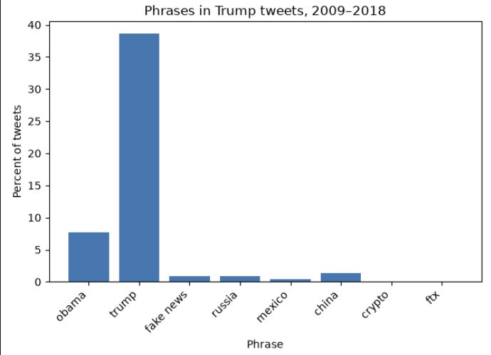

# [lab-web-data](https://csci40.rtealwitter.com/topics/05_web_scraping/lab.html)

| phrase            | percent of tweets |
| ----------------- | ----------------- |
|             obama | 07.73             |
|             trump | 38.58             |
|         fake news | 00.88             |
|            russia | 00.91             |
|            mexico | 00.45             |
|             china | 01.41             |
|            crypto | 00.00             |
|               ftx | 00.00             |

The graph and table show trump is a very common tweet term, followed by Obama, while the other terms which I associate with twitter, did not show up as frequently as I expected